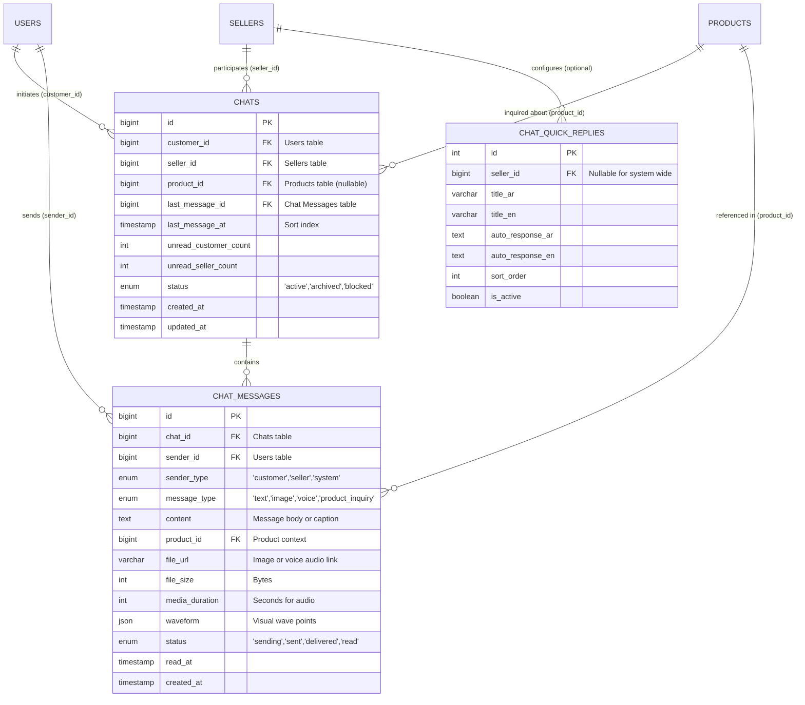

# 📱 وثيقة المواصفات الفنية لنظام المحادثة بين التاجر والمستخدم
# Chat System Backend Architecture & API Specification

> **المشروع:** تطبيق تروند (Troond E-Commerce Platform)  
> **الإصدار:** 1.0  
> **تاريخ التوثيق:** 26 أكتوبر 2026  
> **الهدف:** توثيق شامل ومفصل لقواعد البيانات، الجداول، العلاقات (ERD)، نقاط النهاية (RESTful APIs)، نظام الوقت الحقيقي (WebSockets/Real-Time)، وإشعارات الدفع (FCM Push Notifications) لدعم نظام المحادثات الفورية بين المستخدم (Customer) والتاجر/المتجر (Merchant/Seller).

---

## 📑 فهرس المحتويات (Table of Contents)
1. [نظرة عامة على النظام (System Overview)](#1-نظرة-عامة-على-النظام-system-overview)
2. [هيكلية وتصميم قاعدة البيانات (Database Schema & Tables)](#2-هيكلية-وتصميم-قاعدة-البيانات-database-schema--tables)
3. [مخطط العلاقات بين الجداول (Entity Relationship Diagram - ERD)](#3-مخطط-العلاقات-بين-الجداول-entity-relationship-diagram---erd)
4. [الفهارس واستراتيجيات الأداء (Indexes & Performance)](#4-الفهارس-واستراتيجيات-الأداء-indexes--performance)
5. [نقاط النهاية البرمجية (RESTful API Endpoints)](#5-نقاط-النهاية-البرمجية-restful-api-endpoints)
   - [واجهات المستخدم (Customer APIs)](#51-واجهات-المستخدم-customer-apis)
   - [واجهات التاجر (Merchant/Seller APIs)](#52-واجهات-التاجر-merchantseller-apis)
6. [نظام الوقت الحقيقي والأحداث (Real-Time & WebSockets)](#6-نظام-الوقت-الحقيقي-والأحداث-real-time--websockets)
7. [إشعارات الدفع (FCM Push Notifications)](#7-إشعارات-الدفع-fcm-push-notifications)
8. [الأمان والصلاحيات (Security & Authorization)](#8-الأمان-والصلاحيات-security--authorization)

---

## 1. نظرة عامة على النظام (System Overview)

يهدف نظام المحادثة في "تروند" إلى تمكين التواصل المباشر والسريع بين عملاء المنصة والتجار لزيادة معدل إتمام الطلبات وتقديم تجربة دعم متميزة.
- يدعم النظام:
  - المحادثات النصية الفورية (Real-time Messaging).
  - إرسال الصور والمستندات (Image / Media Attachments).
  - إرسال واستماع التسجيلات الصوتية (Voice Notes with Duration & Waveform).
  - ربط سياق المنتج (Product Inquiry Context) تلقائياً عند بدء المحادثة من صفحة المنتج.
  - الأسئلة الشائعة والردود السريعة (Quick Replies / Suggested Chips).
  - مؤشرات القراءة والوصول (Sent, Delivered, Read Status).
  - مؤشر جاري الكتابة (Typing Indicator) وحالة الاتصال (Online / Offline Presence).

---

## 2. هيكلية وتصميم قاعدة البيانات (Database Schema & Tables)

### 2.1. جدول المحادثات: `chats`
يمثل الجلسة الحوارية بين مشتري معين ومتجر/تاجر معين. في حال بدأ المشتري المحادثة حول منتج، يتم تسجيل `product_id` كسياق أولي.

```sql
CREATE TABLE `chats` (
  `id` BIGINT UNSIGNED NOT NULL AUTO_INCREMENT,
  `customer_id` BIGINT UNSIGNED NOT NULL COMMENT 'المستخدم العميل صاحب المحادثة',
  `seller_id` BIGINT UNSIGNED NOT NULL COMMENT 'التاجر أو المتجر الموجه إليه الشات',
  `product_id` BIGINT UNSIGNED NULL DEFAULT NULL COMMENT 'المنتج المستفسر عنه في بداية الشات',
  `last_message_id` BIGINT UNSIGNED NULL DEFAULT NULL COMMENT 'معرف آخر رسالة مرسلة لتسريع العرض',
  `last_message_at` TIMESTAMP NULL DEFAULT NULL COMMENT 'توقيت آخر رسالة للترتيب الزمني',
  `unread_customer_count` INT UNSIGNED NOT NULL DEFAULT 0 COMMENT 'عدد الرسائل غير المقروءة من قبل العميل',
  `unread_seller_count` INT UNSIGNED NOT NULL DEFAULT 0 COMMENT 'عدد الرسائل غير المقروءة من قبل التاجر',
  `status` ENUM('active', 'archived', 'blocked') NOT NULL DEFAULT 'active',
  `created_at` TIMESTAMP NULL DEFAULT CURRENT_TIMESTAMP,
  `updated_at` TIMESTAMP NULL DEFAULT CURRENT_TIMESTAMP ON UPDATE CURRENT_TIMESTAMP,
  PRIMARY KEY (`id`),
  UNIQUE KEY `unique_customer_seller_chat` (`customer_id`, `seller_id`),
  CONSTRAINT `fk_chats_customer` FOREIGN KEY (`customer_id`) REFERENCES `users` (`id`) ON DELETE CASCADE,
  CONSTRAINT `fk_chats_seller` FOREIGN KEY (`seller_id`) REFERENCES `sellers` (`id`) ON DELETE CASCADE,
  CONSTRAINT `fk_chats_product` FOREIGN KEY (`product_id`) REFERENCES `products` (`id`) ON DELETE SET NULL
) ENGINE=InnoDB DEFAULT CHARSET=utf8mb4 COLLATE=utf8mb4_unicode_ci;
```

---

### 2.2. جدول الرسائل: `chat_messages`
يحتوي على كافة الرسائل المتبادلة بمختلف أنواعها.

```sql
CREATE TABLE `chat_messages` (
  `id` BIGINT UNSIGNED NOT NULL AUTO_INCREMENT,
  `chat_id` BIGINT UNSIGNED NOT NULL COMMENT 'المحادثة التابعة لها هذه الرسالة',
  `sender_id` BIGINT UNSIGNED NOT NULL COMMENT 'معرف صاحب الرسالة',
  `sender_type` ENUM('customer', 'seller', 'system') NOT NULL DEFAULT 'customer',
  `message_type` ENUM('text', 'image', 'voice', 'product_inquiry', 'order_reference') NOT NULL DEFAULT 'text',
  `content` TEXT NULL DEFAULT NULL COMMENT 'النص المكتوب للرسالة أو التسمية التوضيحية',
  `product_id` BIGINT UNSIGNED NULL DEFAULT NULL COMMENT 'إذا كانت الرسالة استفساراً عن منتج محدد',
  `file_url` VARCHAR(2048) NULL DEFAULT NULL COMMENT 'رابط الصورة أو التسجيل الصوتي المرفق',
  `file_size` INT UNSIGNED NULL DEFAULT NULL COMMENT 'حجم الملف المرفق بالبايت',
  `media_duration` INT UNSIGNED NULL DEFAULT NULL COMMENT 'مدة التسجيل الصوتي بالثواني',
  `waveform` JSON NULL DEFAULT NULL COMMENT 'مصفوفة نقاط الموجة الصوتية للتمثيل البصري',
  `status` ENUM('sending', 'sent', 'delivered', 'read') NOT NULL DEFAULT 'sent',
  `read_at` TIMESTAMP NULL DEFAULT NULL COMMENT 'تاريخ ووقت قراءة الرسالة من الطرف المستلم',
  `created_at` TIMESTAMP NULL DEFAULT CURRENT_TIMESTAMP,
  `updated_at` TIMESTAMP NULL DEFAULT CURRENT_TIMESTAMP ON UPDATE CURRENT_TIMESTAMP,
  PRIMARY KEY (`id`),
  CONSTRAINT `fk_messages_chat` FOREIGN KEY (`chat_id`) REFERENCES `chats` (`id`) ON DELETE CASCADE,
  CONSTRAINT `fk_messages_sender` FOREIGN KEY (`sender_id`) REFERENCES `users` (`id`) ON DELETE CASCADE,
  CONSTRAINT `fk_messages_product` FOREIGN KEY (`product_id`) REFERENCES `products` (`id`) ON DELETE SET NULL
) ENGINE=InnoDB DEFAULT CHARSET=utf8mb4 COLLATE=utf8mb4_unicode_ci;
```

---

### 2.3. جدول الردود والأسئلة السريعة: `chat_quick_replies`
يقدم خيارات مسبقة الصنع لتسهيل بدء الاستفسار (مثل: "هل المنتج متوفر؟", "ما هي مدة التوصيل؟").

```sql
CREATE TABLE `chat_quick_replies` (
  `id` INT UNSIGNED NOT NULL AUTO_INCREMENT,
  `seller_id` BIGINT UNSIGNED NULL DEFAULT NULL COMMENT 'إذا كان الرد مخصصاً لمتجر معين، أو NULL للنظام العام',
  `title_ar` VARCHAR(255) NOT NULL,
  `title_en` VARCHAR(255) NOT NULL,
  `auto_response_ar` TEXT NULL DEFAULT NULL COMMENT 'رد آلي اختياري',
  `auto_response_en` TEXT NULL DEFAULT NULL,
  `sort_order` INT NOT NULL DEFAULT 0,
  `is_active` TINYINT(1) NOT NULL DEFAULT 1,
  `created_at` TIMESTAMP NULL DEFAULT CURRENT_TIMESTAMP,
  PRIMARY KEY (`id`),
  CONSTRAINT `fk_quick_replies_seller` FOREIGN KEY (`seller_id`) REFERENCES `sellers` (`id`) ON DELETE CASCADE
) ENGINE=InnoDB DEFAULT CHARSET=utf8mb4 COLLATE=utf8mb4_unicode_ci;
```

---

### 2.4. جدول حالة التواجد والاتصال: `chat_user_presence`
(يمكن تطبيقه في قاعدة البيانات أو عبر **Redis** لتحقيق أقصى سرعة استجابة)

```sql
CREATE TABLE `chat_user_presence` (
  `user_id` BIGINT UNSIGNED NOT NULL,
  `user_type` ENUM('customer', 'seller') NOT NULL,
  `is_online` TINYINT(1) NOT NULL DEFAULT 0,
  `last_seen_at` TIMESTAMP NULL DEFAULT CURRENT_TIMESTAMP,
  PRIMARY KEY (`user_id`, `user_type`)
) ENGINE=InnoDB DEFAULT CHARSET=utf8mb4;
```

---

## 3. مخطط العلاقات بين الجداول (Entity Relationship Diagram - ERD)



---

## 4. الفهارس واستراتيجيات الأداء (Indexes & Performance)

لضمان سرعة استعلام الرسائل حتى مع ملايين السجلات:

1. **فهرس مركب لرسائل المحادثة (Pagination Index):**
   ```sql
   CREATE INDEX `idx_chat_messages_chat_created` ON `chat_messages` (`chat_id`, `created_at` DESC, `id` DESC);
   ```
   *الفائدة:* تسريع استرجاع رسائل المحادثة بالترقيم العكسي (Reverse Pagination) مع تجنب الـ Table Scan.

2. **فهرس فريد لمنع تكرار المحادثة بين نفس العميل ونفس التاجر:**
   ```sql
   CREATE UNIQUE INDEX `idx_chats_customer_seller` ON `chats` (`customer_id`, `seller_id`);
   ```

3. **فهرس ترتيب صندوق المحادثات (Inbox Ordering):**
   ```sql
   CREATE INDEX `idx_chats_customer_last_message` ON `chats` (`customer_id`, `last_message_at` DESC);
   CREATE INDEX `idx_chats_seller_last_message` ON `chats` (`seller_id`, `last_message_at` DESC);
   ```

---

## 5. نقاط النهاية البرمجية (RESTful API Endpoints)

> **Base URL:** `https://api.troond.com/api/v1/`  
> **Headers الإلزامية:**
> ```http
> Authorization: Bearer {token}
> Accept: application/json
> Accept-Language: ar
> Content-Type: application/json
> ```

---

### 5.1. واجهات المستخدم (Customer APIs)

#### 1) فتح محادثة أو استرجاع محادثة حالية:
- **`POST /customer/chats`**
- **Request Body:**
  ```json
  {
    "seller_id": 14,
    "product_id": 1025
  }
  ```
- **Response `200 OK` / `201 Created`:**
  ```json
  {
    "status": true,
    "message": "Chat retrieved successfully",
    "data": {
      "id": 85,
      "seller": {
        "id": 14,
        "name": "متجر التقنية الذكية",
        "logo": "https://api.troond.com/storage/sellers/14.png",
        "rating": 4.9,
        "rating_count": 32,
        "is_verified": true,
        "is_online": true
      },
      "product_context": {
        "id": 1025,
        "title": "سماعة رأس لاسلكية برو",
        "price": "249.00 ر.س",
        "old_price": "299.00 ر.س",
        "image": "https://api.troond.com/storage/products/1025.jpg",
        "in_stock": true
      },
      "unread_count": 0,
      "created_at": "2026-10-26T10:00:00Z"
    }
  }
  ```

---

#### 2) استرجاع سجل رسائل محادثة معينة (Paginated History):
- **`GET /customer/chats/{chat_id}/messages?limit=30&before_id=450`**
- **Response `200 OK`:**
  ```json
  {
    "status": true,
    "data": [
      {
        "id": 449,
        "chat_id": 85,
        "sender_id": 501,
        "sender_type": "customer",
        "type": "text",
        "content": "مرحباً، هل يتوفر لون أسود من هذه السماعة؟",
        "product": null,
        "file_url": null,
        "voice_duration": null,
        "status": "read",
        "read_at": "2026-10-26T10:15:20Z",
        "created_at": "2026-10-26T10:14:00Z"
      },
      {
        "id": 450,
        "chat_id": 85,
        "sender_id": 14,
        "sender_type": "seller",
        "type": "text",
        "content": "أهلاً بك! نعم متوفر وجاهز للشحن الفوري.",
        "product": null,
        "file_url": null,
        "voice_duration": null,
        "status": "read",
        "read_at": "2026-10-26T10:16:00Z",
        "created_at": "2026-10-26T10:15:30Z"
      }
    ],
    "pagination": {
      "has_more": false,
      "next_cursor": null
    }
  }
  ```

---

#### 3) إرسال رسالة نصية أو استفسار منتج:
- **`POST /customer/chats/{chat_id}/messages`**
- **Request Body:**
  ```json
  {
    "content": "هل يوجد ضمان لمدة سنتين؟",
    "type": "text",
    "product_id": null
  }
  ```
- **Response `201 Created`:**
  ```json
  {
    "status": true,
    "data": {
      "id": 451,
      "chat_id": 85,
      "sender_id": 501,
      "sender_type": "customer",
      "type": "text",
      "content": "هل يوجد ضمان لمدة سنتين؟",
      "status": "sent",
      "created_at": "2026-10-26T10:20:00Z"
    }
  }
  ```

---

#### 4) رفع وإرسال صورة (Multipart Request):
- **`POST /customer/chats/{chat_id}/files`**
- **Content-Type:** `multipart/form-data`
- **Fields:**
  - `file`: (ملف الصورة الثنائي JPEG / PNG)
  - `type`: `image`
  - `caption`: "هل هذا الموديل نفسه؟" (اختياري)
- **Response `201 Created`:**
  ```json
  {
    "status": true,
    "data": {
      "id": 452,
      "chat_id": 85,
      "sender_id": 501,
      "type": "image",
      "file_url": "https://api.troond.com/storage/chats/media/img_452.jpg",
      "content": "هل هذا الموديل نفسه؟",
      "status": "sent",
      "created_at": "2026-10-26T10:22:00Z"
    }
  }
  ```

---

#### 5) رفع وإرسال تسجيل صوتي:
- **`POST /customer/chats/{chat_id}/voice`**
- **Content-Type:** `multipart/form-data`
- **Fields:**
  - `voice`: (ملف الصوت AAC / M4A / MP3)
  - `duration`: `14` (المدة بالثواني)
  - `type`: `voice`
- **Response `201 Created`:**
  ```json
  {
    "status": true,
    "data": {
      "id": 453,
      "chat_id": 85,
      "sender_id": 501,
      "type": "voice",
      "file_url": "https://api.troond.com/storage/chats/voice/v_453.m4a",
      "media_duration": 14,
      "waveform": [0.3, 0.6, 0.8, 0.4, 0.9, 0.2, 0.7],
      "status": "sent",
      "created_at": "2026-10-26T10:25:00Z"
    }
  }
  ```

---

#### 6) تمييز الرسائل كمقروءة (Mark as Read):
- **`PATCH /customer/chats/{chat_id}/read`**
- **Response `200 OK`:**
  ```json
  {
    "status": true,
    "message": "Messages marked as read",
    "unread_count": 0
  }
  ```

---

### 5.2. واجهات التاجر (Merchant/Seller APIs)
نفس مسارات الـ APIs متطابقة للتاجر تحت بادئة `/seller/chats/...`، وتتيح للتاجر:
- `GET /seller/chats` (صندوق وارد التاجر مع الرسائل غير المقروءة والفرز بحسب التاريخ).
- `POST /seller/chats/{chat_id}/messages` (الرد على العميل).
- `PATCH /seller/chats/{chat_id}/read` (تحديث حالة قراءة رسائل العميل).

---

## 6. نظام الوقت الحقيقي والأحداث (Real-Time & WebSockets)

لتحقيق محادثة سلسة ولحظية كالواتساب، يعتمد الباك إند على نظام WebSockets (Pusher Protocol أو Laravel Reverb أو Socket.io):

### 6.1. القنوات (Channels)
1. **قناة المحادثة الخاصة:** `private-chat.{chat_id}`
   - يشترك فيها كل من العميل والتاجر المسموح لهما فقط بدخول هذه المحادثة (تتطلب Auth Token).
2. **قناة التنبيهات الشخصية للمستخدم:** `private-user.{user_id}`
   - لتلقي إشعارات ورود رسالة جديدة أثناء تصفح شاشات أخرى في التطبيق لتحديث بادج عدد الرسائل غير المقروءة.

### 6.2. الأحداث المرسلة (Dispatched Events)

| اسم الحدث (Event) | المشغل (Trigger) | محتوى الحمولة (Payload) |
| :--- | :--- | :--- |
| `message.sent` | إرسال رسالة جديدة | كائن الرسالة الكامل (نفس JSON الرسالة) |
| `message.read` | فتح الشات من المستلم | `{"chat_id": 85, "read_by": 14, "read_at": "..."}` |
| `user.typing` | بدء الكتابة في حقل الإدخال | `{"chat_id": 85, "user_id": 501, "is_typing": true}` |
| `user.presence` | تغيير حالة الاتصال | `{"user_id": 14, "status": "online" / "offline"}` |

---

## 7. إشعارات الدفع (FCM Push Notifications)

في حال كان الطرف المستلم غير متصل بالـ WebSocket (التطبيق في الخلفية أو مغلق):
1. يكتشف الباك إند عدم اتصال المستلم بالـ Socket.
2. يتم إرسال إشعار FCM عبر Firebase HTTP v1 API.

### نموذج حمولة الإشعار (FCM Payload):
```json
{
  "message": {
    "token": "dXYZ...device_fcm_token...",
    "notification": {
      "title": "متجر التقنية الذكية",
      "body": "أهلاً بك! نعم متوفر وجاهز للشحن الفوري."
    },
    "data": {
      "type": "chat_message",
      "chat_id": "85",
      "seller_id": "14",
      "sender_name": "متجر التقنية الذكية",
      "click_action": "FLUTTER_NOTIFICATION_CLICK"
    },
    "android": {
      "priority": "high",
      "notification": {
        "sound": "default",
        "channel_id": "troond_chat_channel"
      }
    },
    "apns": {
      "payload": {
        "aps": {
          "sound": "default",
          "badge": 1
        }
      }
    }
  }
}
```

---

## 8. الأمان والصلاحيات (Security & Authorization)

1. **التحقق من الملكية (Chat Authorization Policy):**
   - لا يجوز لأي مستخدم استدعاء `/chats/{id}/messages` إلا إذا كان `customer_id == auth()->id()` أو `seller_id == auth()->seller_id()`.
   - في حال المخالفة، يجب إرجاع كود `403 Forbidden`.
2. **فلترة الملفات المرفوعة (File Upload Validation):**
   - الصور: الحد الأقصى 10MB، الامتدادات المسموحة: `jpg, jpeg, png, webp`.
   - الصوتيات: الحد الأقصى 15MB، الامتدادات المسموحة: `m4a, mp3, aac, wav, ogg`.
3. **الحد من الإغراق (Rate Limiting):**
   - تطبيق Rate Limit بمعدل أقصى 30 رسالة في الدقيقة لمنع الـ Spamming.

---
*تم إعداد هذا الملف بعناية ليكون دليلاً مرجعياً كاملاً وجاهزاً للتنفيذ الفوري من قبل فريق هندسة الباك إند.*
